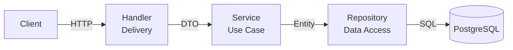

# Ripple backend

The current backend contains email/password authentication plus the first Ripple features: a synthetic dependency graph, deterministic impact preview, brief drafts, ChatGPT brief-summary drafts, and private Cloudflare R2 attachments. Project pages now support summary review, saved storyboard shots, and owner-scoped Higgsfield generation history. Director-note decisions and partial revisions remain separate unfinished work. The Next.js frontend is in the sibling `../ripple-fe` project. See [PRD.md](PRD.md) and [PLAN.md](PLAN.md) for the target product and remaining work.

## Ripple endpoints

| Method | Path | Auth | Purpose |
| --- | --- | --- | --- |
| GET | `/api/v1/demo/graph?scenario=s1` | JWT | Labeled synthetic Laju graph (`s1`, `s2`, `s3`) |
| POST | `/api/v1/impact/preview` | JWT | Calculate impact from submitted points, confirmed links, shots, and diffs |
| GET | `/api/v1/projects` | JWT | List projects owned by the signed-in user |
| POST | `/api/v1/projects` | JWT | Create a project with `name` and optional `description`; returns `brief_id` for private attachments |
| GET | `/api/v1/projects/{projectID}` | JWT | Read an owned project |
| GET | `/api/v1/briefs/storage` | JWT | Check whether R2 is configured (does not verify bucket access) |
| PUT | `/api/v1/briefs/{briefID}/text` | JWT | Capture original text once before confirming a summary |
| GET | `/api/v1/projects/{projectID}/storyboard` | JWT | List saved storyboard shots |
| POST | `/api/v1/projects/{projectID}/storyboard` | JWT | Save 1–50 shots with `title` and `prompt`, plus the current confirmed `summary` |
| POST | `/api/v1/projects/{projectID}/shots/{shotID}/generations` | JWT | Generate `image` or `video` with a UUID `request_key` for idempotency |
| GET | `/api/v1/projects/{projectID}/generations` | JWT | List persistent generation history |
| GET | `/api/v1/projects/{projectID}/generations/{jobID}` | JWT | Poll one owned job and persist its result |
| POST | `/api/v1/briefs/` | JWT | Create a brief draft with `raw_text` (can be empty for attachment-first input) |
| GET | `/api/v1/briefs/{briefID}` | JWT | Read owned brief text and confirmed summary |
| POST | `/api/v1/briefs/{briefID}/summary/draft` | JWT | Ask ChatGPT for a reviewable text summary |
| PUT | `/api/v1/briefs/{briefID}/summary` | JWT | Confirm or edit summary; body: `{"summary":"..."}` |
| POST | `/api/v1/briefs/{briefID}/attachments` | JWT | Create a signed R2 PUT URL; body: `file_name`, `content_type`, `size_bytes` |
| POST | `/api/v1/briefs/{briefID}/attachments/{attachmentID}/complete` | JWT | Verify uploaded object before marking it saved |
| GET | `/api/v1/briefs/{briefID}/attachments` | JWT | List completed attachments |
| GET | `/api/v1/briefs/{briefID}/attachments/{attachmentID}/download` | JWT | Get a short-lived signed R2 GET URL |

For an attachment: create a brief, request an upload URL, PUT bytes to that URL with the returned `Content-Type`, then call `complete`. Files are private, limited to 25 MiB, and stored in R2; PostgreSQL stores their metadata. Configure the R2 bucket CORS to allow PUT from the frontend origin with `Content-Type`. Summaries use raw text plus PNG/JPEG/WEBP/GIF and PDF references through temporary signed URLs. Other file types are downloadable references only. Use a vision-capable `OPENAI_MODEL` for image/PDF inputs. The summary input limit is 10 supported files totaling at most 50 MiB.

Set `R2_ACCOUNT_ID`, `R2_ACCESS_KEY_ID`, `R2_SECRET_ACCESS_KEY`, and `R2_BUCKET` in the server environment. Set `OPENAI_API_KEY` and `OPENAI_MODEL` to enable summary drafts. Set `HF_API_KEY` to the complete copied Higgsfield credential, kept server-side. Apply migrations 19 and 20 before using brief endpoints. The standalone synthetic Go demo runs with `go run ./cmd/demo` on port 8081 without PostgreSQL; its fixture endpoints remain public, and it does not support frontend login.

The default database is now `ripple-be`. An existing PostgreSQL Docker volume initialized with the old database name will not be renamed automatically; create the new database and migrate data as needed before switching `DB_ADDR`.

Apply migration 21 for OTP-free registration: it changes the `is_active` default to true and activates existing inactive accounts so registrations that were waiting for OTP can log in. Apply migrations 22 and 23 before using project pages; they create owner-scoped projects and a linked brief for each project, including existing projects. Create and list project responses include `brief_id`; use that ID with the brief attachment endpoints. The project canvas starts with Raw Brief and adds Brief Summary only after a nonempty summary is saved. The storyboard node appears after shots are saved; image/video nodes appear only for completed jobs with media outputs; the standalone demo graph endpoint is no longer used by project pages. Historical OTP and billing tables remain in migrations to preserve existing database upgrades and records. The PayPal routes and webhook are removed; cancel any existing subscriptions with PayPal directly.

## Clean Architecture



## Layer Responsibilities

| Layer          | Responsibility                                     | Depends On             |
| -------------- | -------------------------------------------------- | ---------------------- |
| **Handler**    | Parse HTTP requests, call service, return response | service, dto, response |
| **Service**    | Business logic, validation, orchestration          | repository, entity     |
| **Repository** | Data access only (no business logic)               | database, entity       |
| **Entity**     | Pure domain/business structs                       | nothing                |
| **DTO**        | API request/response shapes                        | nothing                |

## Stack

- **Go 1.25+** — language
- **Chi** — HTTP router
- **PostgreSQL** — database
- **Cloudflare R2** — private brief attachments
- **ChatGPT/OpenAI API** — brief summaries, summary refinements, and reviewed plan drafts
- **Higgsfield API** — image/video generation with persisted job history
- **Swagger** — API documentation
- **golang-jwt** — JWT authentication
- **validator/v10** — request validation

## Features

- Immediate email/password registration with JWT
- JWT authentication (login, protected routes)
- User profile
- Rate limiting per route group
- Swagger/OpenAPI docs at `/api/v1/swagger/`
- Clean architecture (handler → service → repository → entity)

## Project structure

`cmd/api` wires the server; `cmd/demo` serves the database-free synthetic graph. Features have a separate file in each required layer: `internal/handler`, `internal/service`, `internal/repository`, `internal/entity`, and `internal/dto`. External clients live in `internal/openai`, `internal/higgsfield`, and `internal/r2`. SQL migrations live in `cmd/migrate/migrations`.

## Getting Started

### Prerequisites

- Go 1.25+
- PostgreSQL 16+
- Docker & Docker Compose
- [`migrate`](https://github.com/golang-migrate/migrate) CLI
- [`swag`](https://github.com/swaggo/swag) CLI (for docs generation)

### Setup

**1. Copy environment config**

```bash
cp .envrc.example .envrc
# Edit .envrc with your values
direnv allow .
```

**2. Start PostgreSQL**

```bash
docker compose up -d
```

**3. Run migrations**

```bash
make migrate-up
```

**4. Run the server**

```bash
go run cmd/api/main.go
```

Or with hot reload:
```bash
air
```

Air explicitly sources and exports `.envrc` in its startup command, including after rebuilding. Restart Air once after changing `.air.toml`. Alternatively, `make run` loads `.envrc` and starts the API. With direct `go run`, source `.envrc` first.

API runs on `http://localhost:8080`  
Swagger UI at `http://localhost:8080/api/v1/swagger/`

## Current API Endpoints

| Method | Endpoint                               | Auth | Description           |
| ------ | -------------------------------------- | ---- | --------------------- |
| GET    | `/api/v1/health`                       | —    | Health check          |
| GET    | `/api/v1/projects`                    | ✓    | List owned projects   |
| POST   | `/api/v1/projects`                    | ✓    | Create a project      |
| GET    | `/api/v1/projects/{projectID}`        | ✓    | Get an owned project  |
| PATCH  | `/api/v1/projects/{projectID}`        | ✓    | Edit title and description |
| DELETE | `/api/v1/projects/{projectID}`        | ✓    | Delete project and saved workflow |
| POST   | `/api/v1/auth/register`                | —    | Register and receive JWT |
| POST   | `/api/v1/auth/login`                   | —    | Login                 |
| GET    | `/api/v1/users/me`                     | ✓    | Get profile           |
| GET    | `/api/v1/swagger/*`                    | —    | API docs              |

## Make Commands

```bash
make test              # Run tests
make migration NAME    # Create migration
make migrate-up        # Run migrations
make migrate-down      # Rollback migrations
make gen-docs          # Generate Swagger docs
make seed              # Seed database
```

## Environment Variables

See [`.envrc.example`](.envrc.example) for all available variables.

## Project workflow

Apply migrations through 27 (`migrate ... up`) before using storyboard/generation endpoints. Open Brief to edit source text/references and save a version. Generate a ChatGPT summary or edit one manually. Open Brief Summary, confirm requirements and choose images or video. Images generate a final output directly from the saved summary and requirements; there is no image plan. For video, review a manual or ChatGPT-drafted storyboard, link local requirements, and save it. Generate video outputs per shot, inspect versions in the wide review modal, refine or keep with a reason, and accept the chosen version. Requirement edits show affected and unchanged shots; source-only edits conservatively request review.

For images, click **Generate final image** in Brief Summary, then review/accept it in Final Output. For video, create the final from the storyboard modal after accepting all shots and resolving changes; clips are combined in storyboard order and stored in R2. Install **FFmpeg and ffprobe** (`brew install ffmpeg` on macOS) for video assembly; the Docker runtime includes them. Final videos retain audio, use 1280×720/30fps, and add silence to silent clips. A final is saved only if the brief and accepted selection still match after assembly. Individual clips are limited to 250 MiB and five minutes during assembly. Set `DEMO_ASSET_DIR` if demo files live elsewhere; `/demo-assets/` local files are disabled when `ENV=production`.

Review endpoints (authenticated and owner-scoped): `GET /projects/{id}/review`, `PUT /projects/{id}/brief`, `PUT /projects/{id}/output-type`, `PUT /projects/{id}/shots/{shot}/requirements`, `POST /projects/{id}/shots/{shot}/decisions`, `POST /projects/{id}/summary/refine`, `POST /projects/{id}/plan/draft`, and `POST /projects/{id}/final`. Brief edits require `expected_version`; stale edits are rejected. Keep decisions require a reason.

Generation POSTs are not automatically retried. The frontend keeps the same request key for an uncertain HTTP response, and PostgreSQL prevents duplicate claims and overlapping active jobs of the same type for a shot. A provider timeout or process crash before saving a provider ID leaves `unknown`/`submitting`; reconcile it against the provider dashboard before any further submission. Polling resumes in the project page after refresh; no worker or webhook runs while the page is closed. Output URLs currently remain provider-hosted and may expire; archive them before production use. No paid live generation was run during implementation.

Verified provider contracts: [OpenAI image inputs](https://developers.openai.com/api/docs/guides/images-vision), [OpenAI file inputs](https://developers.openai.com/api/docs/guides/file-inputs), [Higgsfield Soul 2](https://open.higgsfield.ai/models/higgsfield-ai/soul/v2/standard/api-reference), [Higgsfield Seedance 2.0](https://open.higgsfield.ai/models/bytedance/seedance-2.0/text-to-video/api-reference).

R2 upload troubleshooting: `File uploads are temporarily unavailable` means the running API has no configured R2 client. Check that its launch process exports all four R2 variables; settings in a file do not configure an already-running process. The development bucket CORS policy allows the configured `FRONTEND_URL` to make GET, PUT and HEAD requests with Content-Type, exposing ETag. Update the allowed origin if you change frontend hosts or ports. See [Cloudflare CORS guidance](https://developers.cloudflare.com/r2/buckets/cors/). A live signed PUT/preflight/HEAD/delete diagnostic passed on 10 October 2026; the browser modal itself was not exercised in that check.

## Five project-flow demos

`make seed-demo USER_ID=<existing-user-uuid>` creates five owned DEMO projects. Initial project creation is transactional. The review enrichment creates versions, decisions and finals afterward; reruns preserve existing review fixtures and user edits. Apply migrations through 25 first and configure R2. Run it from this repository; it writes generated illustration assets to `../ripple-fe/public/demo-assets` and stores one verified private reference image in R2 for each project. Other users' projects are untouched.

Before first use, place the MDN CC0 flower sample at `../ripple-fe/public/demo-assets/flower.mp4`:

```sh
mkdir -p ../ripple-fe/public/demo-assets
curl --fail --location https://interactive-examples.mdn.mozilla.net/media/cc0-videos/flower.mp4 -o ../ripple-fe/public/demo-assets/flower.mp4
make seed-demo USER_ID=2b90fbea-4a24-475f-a653-794298b5e5cc
```

| Demo | Visible canvas | What to inspect |
| --- | --- | --- |
| DEMO 1 — Brief draft | Raw Brief only | Original brief and uploaded reference; manually confirm a summary to advance |
| DEMO 2 — Direct final image | Brief → Summary → Final Image | Saved source summary, direct image generation and final refinement versions; older collections remain available |
| DEMO 3 — Video change impact | Brief → Summary → Storyboard → two clips → Final Video | Lighting change affects Clip 1 only; refined version awaits approval, Clip 2 is unchanged, earlier final remains playable |

| DEMO 4 — Brief and summary only | Brief → Brief Summary | Review the summary, then choose image or video; no plan, media, or final output is seeded |

| DEMO 5 — Storyboard ready | Brief → Brief Summary → Storyboard | Three planned shots, with no generations or final output |

Seeded media and summaries are explicitly synthetic samples; no ChatGPT or Higgsfield generation is called. The illustrations are drawn locally; the video is the MDN CC0 flower clip. Sample output paths use the frontend's `/demo-assets/` directory. Only terminal job states are seeded, so opening the projects does not poll fake provider IDs. Clicking a real Generate action afterwards still uses the normal paid provider integration. These demos include explicit requirement changes, selective impact, preserved media versions, acceptance, and a real combined final MP4 in R2. Prepared revisions use sample media, not AI-generated changes.

To remove the demos, delete only the five `DEMO 1/2/3/4/5` project records for this owner (dependent briefs, attachments, shots and jobs cascade), then remove their reference objects beneath `demo/<user-id>/<project-id>/` from R2. Avoid deleting real projects by name pattern alone.

## Project table and destructive actions

`/project` uses a shadcn table with title, description, creator username, creation date, and Edit/Delete actions. Editing only changes project metadata. Every response includes `created_by`; only owned projects can be edited or deleted. Shadcn Alert Dialog confirms project deletion, clearing brief/summary text, removing references or requirements, and removing planned shots or selected upload files. Failed deletion keeps the alert open with an error and preserves the row.

Apply migration 26 for the durable storage cleanup queue. Project deletion and queueing all source/archived attachments and final video keys happen in one database transaction. Workflow records cascade immediately. R2 objects are removed by the API's cleanup loop after 15 minutes, allowing previously issued upload links to expire; failures remain queued and retry every minute while the API runs. Provider-hosted media and frontend demo illustration files are shared/external assets and are not deleted from those hosts.

### Final output refinement

Open the Final Output node, choose a saved version (and an image for a collection), then use **Adjust / Refine**. Enter adjustments and a reason, generate a candidate, compare it with its source, and **Mark as accepted**. Only accepted, completed versions appear on the final canvas node. The original source nodes and previous final outputs remain unchanged.

Migration 27 adds final refinement status, source-version links, prompts/reasons, idempotency keys, and one accepted final per project/media type. `/projects/{projectID}/finals/{finalID}/refinements` submits an edit; GET `/projects/{projectID}/finals/{finalID}` polls status; POST `/projects/{projectID}/finals/{finalID}/accept` accepts a completed version. Every route is authenticated and owner-scoped. Stale brief versions, changed source approvals, and unresolved impacts must be reviewed and rebuilt before refinement or acceptance.

Higgsfield Soul 2 image-to-image takes the selected final image as `image_url`; Seedance 2.5 video-edit takes the combined final video as `video_url`. Image edits replace only the selected member of the final collection. Refined outputs currently use provider-hosted URLs; assembled videos continue to use private R2. Local `/demo-assets` URLs are not valid provider references. Paid submissions are never automatically retried after an ambiguous timeout.

Image generation uses POST `/projects/{projectID}/images` with `request_key` and `expected_version`. The backend reads the saved summary and requirements under a brief lock, submits one Higgsfield image request, and stores it directly in final-output history. It creates no storyboard shots or intermediate image plan. Completed initial images appear as pending approval; accepting chooses the active final, and subsequent refinements preserve its history.
