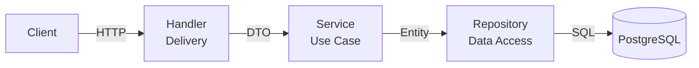

# Ripple backend

The current backend contains account/billing infrastructure plus the first Ripple features: a synthetic dependency graph, deterministic impact preview, brief drafts, ChatGPT brief-summary drafts, and private Cloudflare R2 attachments. Higgsfield image/video submission and status are implemented as a server-side client; generation jobs are not yet connected to shot decisions. The Next.js frontend is in the sibling `../ripple-fe` project. See [PRD.md](PRD.md) and [PLAN.md](PLAN.md) for the target product and remaining work.

## Ripple endpoints

| Method | Path | Auth | Purpose |
| --- | --- | --- | --- |
| GET | `/api/v1/demo/graph?scenario=s1` | No | Labeled synthetic Laju graph (`s1`, `s2`, `s3`) |
| POST | `/api/v1/impact/preview` | No | Calculate impact from submitted points, confirmed links, shots, and diffs |
| POST | `/api/v1/briefs/` | JWT | Create a brief draft with `raw_text` (can be empty for attachment-first input) |
| GET | `/api/v1/briefs/{briefID}` | JWT | Read owned brief text and confirmed summary |
| POST | `/api/v1/briefs/{briefID}/summary/draft` | JWT | Ask ChatGPT for a reviewable text summary |
| PUT | `/api/v1/briefs/{briefID}/summary` | JWT | Confirm or edit summary; body: `{"summary":"..."}` |
| POST | `/api/v1/briefs/{briefID}/attachments` | JWT | Create a signed R2 PUT URL; body: `file_name`, `content_type`, `size_bytes` |
| POST | `/api/v1/briefs/{briefID}/attachments/{attachmentID}/complete` | JWT | Verify uploaded object before marking it saved |
| GET | `/api/v1/briefs/{briefID}/attachments` | JWT | List completed attachments |
| GET | `/api/v1/briefs/{briefID}/attachments/{attachmentID}/download` | JWT | Get a short-lived signed R2 GET URL |

For an attachment: create a brief, request an upload URL, PUT bytes to that URL with the returned `Content-Type`, then call `complete`. Files are private, limited to 25 MiB, and stored in R2; PostgreSQL stores their metadata. Configure the R2 bucket CORS to allow PUT from the frontend origin with `Content-Type`. The API currently saves arbitrary file types but only summarizes `raw_text`; it does not extract text or visual content from attachments yet.

Set `R2_ACCOUNT_ID`, `R2_ACCESS_KEY_ID`, `R2_SECRET_ACCESS_KEY`, and `R2_BUCKET` in the server environment. Set `OPENAI_API_KEY` and `OPENAI_MODEL` to enable summary drafts. Keep `HF_API_KEY` server-side for the future generation-job endpoints. Apply migrations 19 and 20 before using brief endpoints. The standalone synthetic Go demo runs with `go run ./cmd/demo` on port 8081 without PostgreSQL.

The default database is now `ripple-be`. An existing PostgreSQL Docker volume initialized with the old database name will not be renamed automatically; create the new database and migrate data as needed before switching `DB_ADDR`.

## Clean Architecture



## Layer Responsibilities

| Layer          | Responsibility                                     | Depends On             |
| -------------- | -------------------------------------------------- | ---------------------- |
| **Handler**    | Parse HTTP requests, call service, return response | service, dto, response |
| **Service**    | Business logic, validation, orchestration          | repository, entity     |
| **Repository** | Data access only (no business logic)               | database, entity       |
| **Entity**     | Pure domain/business structs                       | nothing                |
| **DTO**        | API request/response shapes                        | nothing                |

## Stack

- **Go 1.25+** — language
- **Chi** — HTTP router
- **PostgreSQL** — database
- **Cloudflare R2** — private brief attachments
- **ChatGPT/OpenAI API** — brief-summary drafts and planned text operations
- **Higgsfield API** — image/video generation client (job endpoints pending)
- **Resend** — transactional email (OTP)
- **PayPal** — subscription billing
- **Swagger** — API documentation
- **golang-jwt** — JWT authentication
- **validator/v10** — request validation

## Features

- OTP-based email verification & registration
- JWT authentication (login, protected routes)
- User profile & billing info
- PayPal subscription (create, cancel, webhook)
- Rate limiting per route group
- Swagger/OpenAPI docs at `/api/v1/swagger/`
- Clean architecture (handler → service → repository → entity)

## Project structure

`cmd/api` wires the server; `cmd/demo` serves the database-free synthetic graph. Features have a separate file in each required layer: `internal/handler`, `internal/service`, `internal/repository`, `internal/entity`, and `internal/dto`. External clients live in `internal/openai`, `internal/higgsfield`, and `internal/r2`. SQL migrations live in `cmd/migrate/migrations`.

## Getting Started

### Prerequisites

- Go 1.25+
- PostgreSQL 16+
- Docker & Docker Compose
- [`migrate`](https://github.com/golang-migrate/migrate) CLI
- [`swag`](https://github.com/swaggo/swag) CLI (for docs generation)

### Setup

**1. Copy environment config**

```bash
cp .envrc.example .envrc
# Edit .envrc with your values
direnv allow .
```

**2. Start PostgreSQL**

```bash
docker compose up -d
```

**3. Run migrations**

```bash
make migrate-up
```

**4. Run the server**

```bash
go run cmd/api/main.go
```

Or with hot reload:
```bash
air
```

API runs on `http://localhost:8080`  
Swagger UI at `http://localhost:8080/api/v1/swagger/`

## Current API Endpoints

| Method | Endpoint                               | Auth | Description           |
| ------ | -------------------------------------- | ---- | --------------------- |
| GET    | `/api/v1/health`                       | —    | Health check          |
| POST   | `/api/v1/auth/register`                | —    | Register user         |
| POST   | `/api/v1/auth/otp/send`                | —    | Send OTP              |
| POST   | `/api/v1/auth/otp/verify`              | —    | Verify OTP & activate |
| POST   | `/api/v1/auth/login`                   | —    | Login                 |
| GET    | `/api/v1/users/me`                     | ✓    | Get profile           |
| GET    | `/api/v1/users/billing`                | ✓    | Get billing info      |
| POST   | `/api/v1/billing/paypal/subscriptions` | ✓    | Create subscription   |
| DELETE | `/api/v1/billing/paypal/subscriptions` | ✓    | Cancel subscription   |
| POST   | `/api/v1/billing/paypal/webhook`       | —    | PayPal webhook        |
| GET    | `/api/v1/swagger/*`                    | —    | API docs              |

## Make Commands

```bash
make test              # Run tests
make migration NAME    # Create migration
make migrate-up        # Run migrations
make migrate-down      # Rollback migrations
make gen-docs          # Generate Swagger docs
make seed              # Seed database
```

## Environment Variables

See [`.envrc.example`](.envrc.example) for all available variables.
